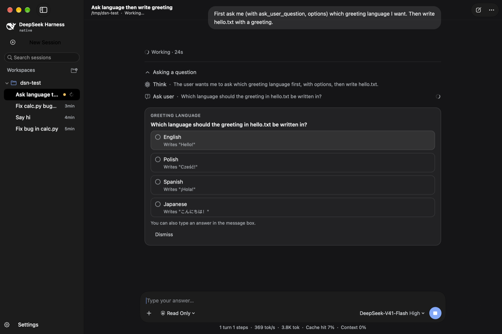
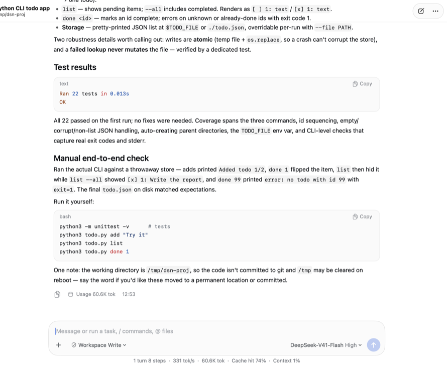

# DeepSeek Native

A native macOS client for the [DeepSeek Harness](https://github.com/deepseek-ai/deepseek-harness) coding agent, written in Swift and AppKit.

The Harness normally runs as a Node.js server plus a React web UI in a browser tab. This project reimplements the agent loop, its tools and the chat UI as one small Mac app. It has no web views, no Electron and no SwiftUI. The transcript is drawn by a custom Core Text renderer designed to look like the Harness web UI, and the window uses macOS Liquid Glass.

<p align="center">
  
</p>
<p align="center">
  
</p>

> [!NOTE]
> This is an independent project, not affiliated with or endorsed by DeepSeek. It needs your own DeepSeek API key.

## Highlights

- **Native and lightweight.** The binary is about 2.5 MB. There's one process and no bundled browser or Node runtime.
- **Same agent as the Harness.** It uses the same DeepSeek Messages API, a system prompt adapted from the Harness, and the same tool schemas, so the model behaves the same way.
- **Custom transcript renderer.** It supports Markdown with tables, task lists and syntax-highlighted code, and tool calls fold into collapsible groups. Text can be selected and copied across the whole conversation. Only visible content is drawn, and only changed items are laid out again.
- **Sandboxed shell.** Commands run under `sandbox-exec` in the Read Only and Workspace Write modes. Writes outside the allowed area show an inline approval card.
- **Uses your existing Harness setup.** On first launch it reads your API key from `~/.dsh` and imports your Harness sessions.

## Requirements

- macOS 26 or later (Liquid Glass APIs), Apple silicon
- Xcode 26 or later (Swift 6.2 toolchain)
- A [DeepSeek API key](https://platform.deepseek.com/)
- Optional: `zstd` or `node` on your `PATH` to import existing Harness sessions. The build bundles ripgrep for `glob`/`grep` when `rg` is available; otherwise a pure-Swift fallback is used.

## Build and run

```sh
git clone https://github.com/lszl84/deepseek-native.git
cd deepseek-native
./build.sh                 # release build → build/DeepSeek.app
open build/DeepSeek.app
```

`./build.sh debug` produces a debug build. To install the app, copy `build/DeepSeek.app` into `/Applications`. The app is signed ad hoc, so the first launch may need right-click → **Open**.

The app finds your API key in this order:

1. `~/Library/Application Support/DeepSeek Native/settings.json` (set in **Settings → Models**)
2. the `DEEPSEEK_API_KEY` environment variable
3. `DEEPSEEK_API_KEY` in the Harness credential file `~/.dsh/.credentials.yaml`

`DEEPSEEK_BASE_URL` overrides the endpoint. The default is `https://api.deepseek.com/anthropic`.

## Features

### Agent

| | |
|---|---|
| API | DeepSeek's Anthropic-compatible Messages API with SSE streaming. Thinking blocks and their signatures are replayed, and prompt caching applies. |
| Models | `deepseek-flash` (DeepSeek-V41-Flash) and `deepseek-v4-pro`, with reasoning effort off, low, high or max. |
| Tools | `bash`, `read`, `write`, `edit`, `read_image`, `glob`, `grep`, `web_search` (DeepSeek native search), `web_fetch`, `todo_write`, `ask_user_question`, `subagent`, `job_list`, `job_output`, `job_kill`, `present` |
| Safety | `read` must come before `write` or `edit` on an existing file. Output is truncated with the full text saved to a spill file. A command that times out moves to a background job instead of being killed. |
| Control | Stop cancels the stream and kills the command's whole process group. A message sent while the agent runs is added to its next step. Retryable API errors are retried with backoff. |
| Context | Once the prompt passes 80% of the context window, older history is summarized automatically. |
| Project instructions | `AGENTS.md` or `CLAUDE.md` in the workspace root, plus custom instructions from Settings |

### Permission modes

| Mode | Shell commands | File tools |
|---|---|---|
| Read Only | Sandboxed. Writes are allowed only in temp and cache directories. | Every write asks for approval. |
| Workspace Write | Sandboxed. Writes are allowed inside the workspace. | Writes outside the workspace ask for approval. |
| Full Access | No sandbox. | No approvals. |

### Interface

- **Sidebar:** workspaces and their sessions, with search, pin, archive, rename, delete, a spinner for running sessions and an attention dot for sessions waiting on you.
- **Transcript:** matches the web UI, with "Took 12s" turn headers, groups such as "Ran commands" or "Wrote files and ran commands", and expandable tool details (command output, diffs, checklists, sources, subagent results). Approval and question cards appear inline, and each turn ends with a footer showing copy, token usage and time.
- **Composer:** a glass message box where Return sends and Shift-Return adds a line. `@` completes workspace files and `/` offers commands. You can attach files by dragging or pasting, and paste images directly. Permission and model/effort menus sit in the composer.
- **Status line:** turns, steps, tokens per second, total tokens, cache hit rate and context usage.
- **Other:** light and dark mode, Settings (General, Models, Agent), Markdown export, a dock badge while sessions run, and basic VoiceOver support for the transcript.

Keyboard shortcuts:

| Shortcut | Action |
|---|---|
| ⌘N | New session |
| ⌘O | Open workspace |
| ⌘. | Stop |
| ⌘R | Retry last turn |
| ⌘L | Focus message box |
| ⇧⌘C | Copy last response |
| ⇧⌘E | Export as Markdown |
| ⌃⌘S | Toggle sidebar |

## Performance

These numbers come from the author's machine (Apple silicon, 5K display) during real sessions.

| | DeepSeek Native |
|---|---|
| CPU at idle | ~0% |
| CPU while the agent streams and runs tools | 1–5% on average, with short spikes to about 15% |
| App heap (sessions, parsed Markdown, layouts) | ~35 MB |
| Total memory footprint | ~70 MB before the window draws, ~400 MB with a large window on screen |

Most of the on-screen footprint (~236 MB of GPU memory plus ~90 MB of window surfaces) is what macOS charges for a large Retina window on a 5K display. On the same machine Terminal shows a similar ~200 MB of GPU memory for its window. For comparison, the Harness's Node server alone uses about 200 MB before counting the browser tab.

The renderer keeps this low in several ways:

- The drawing canvas covers only the visible area.
- Items are keyed and carry a signature, so an item is re-parsed only when its content changes.
- Streaming text is split into a stable prefix that is parsed once and a live tail.
- Only changed regions are repainted, and UI updates are limited to 20 per second.
- The spinner timer runs only while something is animating.
- Idle sessions are unloaded from memory.

## How it works

```
Sources/DeepSeek/
├── App/          entry point, menus, headless mode, debug hooks
├── Core/         JSON value type, settings and paths
├── LLM/          streaming Messages client (URLSession + SSE)
├── Agent/        agent loop, system prompt, tool registry, jobs, process spawning
│   └── Tools/    bash (+ sandbox), file tools, web tools, misc tools
├── Store/        session model and JSONL log, session index, Harness importer
└── UI/           window, sidebar, chat view, composer, settings, theme
    └── Transcript/  Markdown parser, syntax highlighter, Core Text layout,
                     element tree, transcript builder, transcript view
```

- **Agent loop** (`Agent.swift`): each step streams one Messages request. Tool calls run afterwards, concurrently when they are read-only and one at a time otherwise. Their results are sent back until the model stops calling tools. Session state is changed only on the main thread.
- **Sessions** are append-only JSONL event logs in `~/Library/Application Support/DeepSeek Native/sessions/`, loaded lazily when opened.
- **Rendering:** `TranscriptBuilder` turns a session into keyed item specs. `TranscriptView` lays each item out once per width with Core Text and draws only the items that intersect the dirty rect. Selection works across items through a document-order list of text layouts.

## Development

The Play button (or anything else that wants a single build-and-run command) can use:

```sh
(osascript -e 'quit app "DeepSeek"' >/dev/null 2>&1; sleep 1; pkill -f "DeepSeek.app/Contents/MacOS/DeepSeek"; true) && ./build.sh release && open build/DeepSeek.app
```

Headless mode runs one agent task in the terminal, with no GUI:

```sh
swift build
.build/debug/DeepSeek --headless "Find the bug in calc.py and fix it" --cwd /path/to/project
```

These environment variables drive automated GUI testing. They have no effect when unset:

| Variable | Effect |
|---|---|
| `DSN_WORKSPACE` | Start a new session in that directory |
| `DSN_AUTOSEND` | Send a prompt once the window is up |
| `DSN_OPEN` | Open that session ID |
| `DSN_SNAPSHOT` | Write window snapshots to that path every `DSN_SNAPSHOT_INTERVAL` seconds |
| `DSN_APPEARANCE` | Force `light` or `dark` |
| `DSN_PERMISSION` | Set the permission mode |
| `DSN_AUTOANSWER` | Auto-answer questions and approvals after that many seconds |
| `DSN_DEBUG` | Print debug logs to stderr |

## Not ported

Parts of the Harness that depend on its Node plugin architecture aren't included:

- the plugin system and plugin manager
- MCP servers
- LSP
- persistent terminal tools
- workflows, goals, scheduling and plan mode
- the Python SDK
- the Trajectory view

## License

[MIT](LICENSE). Third-party material, including DeepSeek Harness assets and tool definitions, is listed in [THIRD_PARTY_NOTICES.md](THIRD_PARTY_NOTICES.md).
